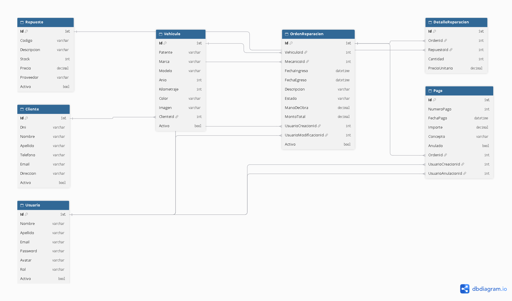

# 🔧 AutoGest - Sistema de Gestión para Talleres Mecánicos

TP Final - ASP.NET Core 8 MVC + Vue 3 + JWT + Cloudinary + MySQL

## 📋 Descripción

AutoGest es un sistema web MVC que digitaliza por completo la operación de un taller mecánico: gestión de clientes, vehículos, órdenes de reparación, repuestos y pagos.

## 🛠️ Tecnologías

- ASP.NET Core 8 MVC
- Entity Framework Core + Pomelo MySQL
- Vue 3 (CDN) para el ABM de Clientes
- JWT para la API REST
- Cloudinary para avatares e imágenes de vehículos
- BCrypt para hashing de contraseñas
- Select2 para búsquedas asíncronas

## ✅ Matriz de Evidencias de Requerimientos

| Requerimiento | Estado | Ubicación / Evidencia |
|---|---|---|
| 6+ clases relacionadas (1:N y N:M) | ✅ | `Data/ApplicationDbContext.cs` + `docs/der.png` |
| Login/Logout + Roles | ✅ | `Controllers/AccountController.cs`, `Program.cs` |
| Funcionalidad restringida por rol | ✅ | `[Authorize(Policy = "Administrador")]` en Usuarios, Delete |
| Avatar de usuario | ✅ | `PerfilController.CambiarAvatar` (Cloudinary) |
| Manejo de archivos extra | ✅ | `VehiculosController.Create` (imagen de vehículo) |
| ABM con Vue.js + AJAX | ✅ | `Views/Clientes/VueIndex.cshtml` + `ClientesController` |
| Paginado servidor | ✅ | `Repository.GetPagedAsync` en todos los listados |
| Búsqueda asíncrona | ✅ | `BuscarClientes`, `BuscarVehiculos`, `BuscarMecanicos`, `BuscarRepuestos` |
| Web API con JWT | ✅ | `Controllers/Api/AuthController.cs`, `VehiculosApiController.cs` |

## 🔐 Usuarios de Prueba

| Rol | Email | Password |
|---|---|---|
| Administrador | admin@autogest.com | admin123 |
| Empleado/Mecánico | pedro@autogest.com | empleado123 |

## 🚀 Cómo ejecutar

```bash
dotnet restore
dotnet ef migrations add InitialCreate
dotnet ef database update
dotnet run


📡 Endpoints API

POST /api/auth/login - Body: { "email": "admin@autogest.com", "password": "admin123" }

GET /api/vehiculosapi (público)

POST /api/vehiculosapi (Admin, requiere Bearer)

PUT /api/vehiculosapi/{id} (Admin)

DELETE /api/vehiculosapi/{id} (Admin)

📦 Estructura del Proyecto

Ver árbol completo en el repositorio.

🎯 Modelo de Datos

Cliente 1:N Vehículo

Vehículo 1:N OrdenReparacion

OrdenReparacion 1:N DetalleReparacion

Repuesto 1:N DetalleReparacion (relación N:M entre Orden y Repuesto vía Detalle)

OrdenReparacion 1:N Pago

Usuario 1:N OrdenReparacion (como mecánico asignado)

 Diagrama DER

Ver imagen en 

El modelo consta de 7 tablas: Cliente, Vehiculo, OrdenReparacion, DetalleReparacion, Repuesto, Pago y Usuario.

## 💾 Base de Datos

Script completo con datos de prueba: [`scripts/autogest_db.sql`](scripts/autogest_db.sql)


┌─────────────┐          ┌──────────────┐          ┌────────────────────┐
│  Cliente    │ 1──────N │  Vehiculo    │ 1──────N │  OrdenReparacion   │
├─────────────┤          ├──────────────┤          ├────────────────────┤
│ Id (PK)     │          │ Id (PK)      │          │ Id (PK)            │
│ Dni         │          │ Patente      │          │ VehiculoId (FK)    │
│ Nombre      │          │ Marca        │          │ MecanicoId (FK)    │
│ Apellido    │          │ Modelo       │          │ FechaIngreso       │
│ Telefono    │          │ Anio         │          │ FechaEgreso        │
│ Email       │          │ Kilometraje  │          │ Descripcion        │
│ Direccion   │          │ Imagen       │          │ Estado             │
│ Activo      │          │ ClienteId FK │          │ ManoDeObra         │
└─────────────┘          │ Activo       │          │ MontoTotal         │
                         └──────────────┘          │ UsuarioCreacionId  │
                                                   │ UsuarioModificacion│
                                                   │ Activo             │
                                                   └────────────────────┘
                                                            │
                                              ┌─────────────┼─────────────┐
                                              │ 1           │ 1           │ N
                                              │ N           │ N           │ 1
                                              ▼             ▼             ▼
                                      ┌───────────────┐  ┌──────────┐  ┌───────────┐
                                      │DetalleReparac.│  │  Pago    │  │  Usuario  │
                                      ├───────────────┤  ├──────────┤  ├───────────┤
                                      │ Id (PK)       │  │ Id (PK)  │  │ Id (PK)   │
                                      │ OrdenId (FK)  │  │ Numero   │  │ Nombre    │
                                      │ RepuestoId FK │  │ Fecha    │  │ Apellido  │
                                      │ Cantidad      │  │ Importe  │  │ Email     │
                                      │ PrecioUnit.   │  │ Concepto │  │ Password  │
                                      └───────┬───────┘  │ Anulado  │  │ Avatar    │
                                              │ N        │ OrdenId  │  │ Rol       │
                                              │ 1        │ UsuarioC.│  └───────────┘
                                              ▼          │ UsuarioA.│
                                      ┌───────────────┐  └──────────┘
                                      │   Repuesto    │
                                      ├───────────────┤
                                      │ Id (PK)       │
                                      │ Codigo        │
                                      │ Descripcion   │
                                      │ Stock         │
                                      │ Precio        │
                                      │ Proveedor     │
                                      └───────────────┘